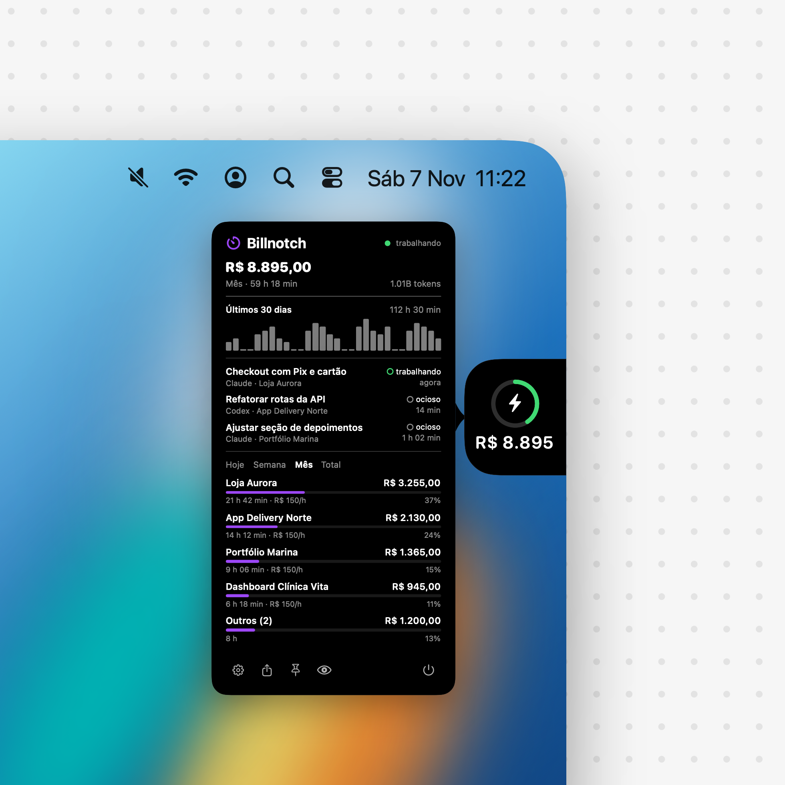

<p align="center">
  
</p>

<h1 align="center">Billnotch</h1>

<p align="center">
  <strong>Quanto vale cada projeto que você faz com Claude Code e Codex?</strong><br>
  Um notch discreto na borda da tela que soma suas horas e mostra o valor, em tempo real.
</p>

<p align="center">
  macOS 14+ · 100% local · sem conta · sem servidor
</p>

---

## O que é

Você cadastra o seu **valor por hora**. Enquanto trabalha com o Claude Code ou o Codex, o Billnotch conta o tempo de cada projeto e mostra, numa aba presa na borda da tela, **quanto aquele trabalho vale**. Passe o mouse e o cartão abre com o detalhe.

Feito para quem cobra por projeto e quer saber, com números, se o preço fechado compensou.

## O que você vê

- **Valor total** do período (hoje, semana, mês ou tudo), com as horas somadas.
- **Cada projeto** com horas, valor e a fatia do total.
- **Sessões em andamento**, com o estado de cada uma (trabalhando ou ocioso).
- **Gráfico dos últimos 30 dias** de trabalho.
- **Real ou dólar**, no total ou por projeto, com cotação que você define.
- **Modo gravação**: um clique troca todo valor em dinheiro por `••••••`, para gravar a tela sem expor o que você cobra.
- **Quatro bordas**: direita, esquerda, topo (ao lado da câmera) ou base. Segure `⌥` e arraste para deslizar a aba ao longo da borda.
- **Exportar CSV** do período para montar o orçamento ou a nota.

## Como o tempo é contado

O Billnotch não precisa de plugin nem de hook. Ele lê os registros que o Claude Code (`~/.claude/projects`) e o Codex (`~/.codex/sessions`) já gravam no seu Mac.

- Dois registros seguidos com até **10 minutos** de intervalo contam como trabalho contínuo. Pausas maiores não contam. O limite é ajustável.
- Sessões **simultâneas no mesmo projeto não contam em dobro**.
- O projeto é a **raiz do git** da pasta onde você trabalhou (ou a própria pasta).
- Como lê o histórico que já existe, **os números aparecem desde a primeira abertura**.

**Valor = horas × valor da hora do projeto** (ou o valor padrão).

> O tempo mede atividade com a IA, não o tempo total que você ficou na frente do computador. Use como uma base honesta para cobrar, não como ponto eletrônico.

## Privacidade

- Tudo roda **no seu Mac**. Não há conta, servidor nem telemetria.
- O app lê só **horários, pasta do projeto, título da sessão e a contagem de tokens**. **Nunca lê o conteúdo das mensagens** nem o que o agente escreveu ou viu.
- A única chamada de rede é a **verificação de atualização**, que só acontece se você configurar um endereço (veja abaixo) e pode ser desligada.

## Instalação

1. Baixe o `Billnotch.dmg`.
2. Abra o arquivo e arraste o **Billnotch** para **Applications**.
3. Abra o app. Na primeira vez, o macOS pode pedir confirmação: clique com o botão direito no app, **Abrir**, e confirme.
4. Em **Configurações > Valor e moeda**, ajuste o seu valor por hora.

O app roda sem ícone no Dock. O ícone fica na barra de menus, e as configurações abrem por ali ou com o botão direito na aba. Para encerrar, use o botão de power do cartão.

## Junto com o Editnotch

Se o Billnotch e o Editnotch estiverem abertos ao mesmo tempo, as duas abas se juntam num notch só, na mesma borda: o Billnotch em cima (ou à esquerda) e o Editnotch embaixo (ou à direita). Mudar a borda ou arrastar com `⌥` em um move o outro, e abrir o cartão de um fecha o do outro. Eles combinam por avisos locais do sistema, sem rede.

## Atualizações

Com o app em Aplicativos, ele baixa a versão nova em segundo plano, confere o SHA-256 (se informado) e troca o app quando você o encerra, ou na hora com **Reiniciar e atualizar**. Fora de Aplicativos, só avisa e abre o download.

O app consulta, no máximo uma vez por dia, um arquivo JSON que **você** publica:

```json
{
  "version": "0.3.0",
  "url": "https://seusite.com/downloads/Billnotch.dmg",
  "sha256": "(opcional) hash do DMG, gerado pelo make-dmg.sh",
  "notes": "O que mudou nesta versão."
}
```

1. Publique o `.dmg` e o JSON no seu site (ou use a API de releases do GitHub, que também é aceita).
2. Preencha `UpdateFeedURL` em `Resources/Info.plist` com o endereço do JSON.
3. Aumente `CFBundleShortVersionString` a cada versão e gere o DMG de novo.

Quando houver versão mais nova, o app mostra um aviso na barra de menus e em **Configurações > Geral**, com o botão **Baixar**. Para testar o endereço sem abrir o app:

```bash
.build/release/Billnotch --check-update https://seusite.com/latest.json
```

Um exemplo está em [`docs/latest.example.json`](docs/latest.example.json). A atualização é manual (baixa e instala o DMG). Instalação automática exigiria assinatura e notarização com uma conta de desenvolvedor Apple.

## Compilar do código

Precisa do Xcode (ou das Command Line Tools) com Swift 5.9+.

```bash
Scripts/build-app.sh run     # compila e abre build/Billnotch.app
Scripts/make-dmg.sh          # gera build/Billnotch.dmg
```

Ferramentas de apoio:

```bash
.build/release/Billnotch --report month   # números no terminal (today | week | month | all)
.build/release/Billnotch --hero docs/hero.png   # regera a imagem de divulgação (dados fictícios)
```

O app é assinado só de forma ad-hoc. Para distribuir sem aviso do macOS, assine com um Developer ID e notarize.

## Estrutura

| Arquivo | Papel |
| --- | --- |
| `Indexer.swift` | Lê os registros do Claude/Codex de forma incremental e monta as sessões de trabalho |
| `Store.swift` | Soma por projeto e período, converte moeda, gera o CSV |
| `NotchViews.swift`, `NotchController.swift` | Aba, cartão com bico, hover, ⌥-arrastar e bordas |
| `SettingsView.swift`, `Settings.swift` | Janela de configurações e preferências |
| `Updater.swift` | Verificação de atualização |

## Contribuir

Contribuições são bem-vindas: veja o [CONTRIBUTING.md](CONTRIBUTING.md). A regra principal é a privacidade: o app nunca lê o conteúdo das mensagens.

## Site

A pasta `site/` é uma landing page estática (HTML, CSS e JS, sem build). Para publicar na Vercel, importe a pasta `site`. O botão de download usa o endereço do campo `url` de `site/latest.json`, então aponte esse campo para o `.dmg` publicado em **GitHub Releases** (o DMG não vai no repositório).

## Licença

[MIT](LICENSE).

---

<p align="center">Inspirado no <a href="https://github.com/vinzdg/codenotch">Codenotch</a>.</p>
